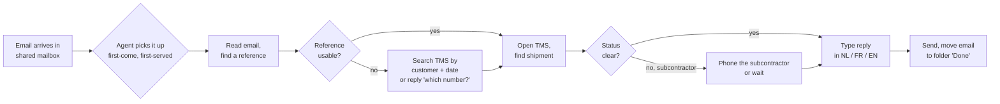

# AS-IS process and interviews

> *Fictional. Interviews are written as a consultant would summarise them; no real people.*

## AS-IS: a status email today

**Pain points** (from the interviews and the timing study):

| # | Pain point | Cost |
|---|---|---|
| P1 | No triage: a damage claim waits behind 40 status questions | key accounts escalate to sales |
| P2 | Finding the shipment from a PO number means a TMS search per customer | ±1.5 min of every status email |
| P3 | French emails wait for one of three French-speaking agents | 5.2 h median first response |
| P4 | Out-of-office replies to Corlaan's own notifications fill the mailbox | ±45 emails a day deleted by hand |
| P5 | Stale subcontractor status: agents answer "on its way" and are wrong | repeat emails, phone calls |
| P6 | Nobody measures anything; the team lead counts the mailbox by eye | no baseline, no argument for or against the hire |

## Baseline KPIs (2 normal weeks)

| KPI | Baseline | Source |
|---|---|---|
| Median first response, status/POD emails | 2.9 h (NL/EN 2.4 h, FR 5.2 h) | Exchange message trace, sample |
| Emails handled per agent per day | ±58 | team lead |
| Repeat emails ("2nd time I ask") | 12% of status emails | labelled sample |
| Agent time on status + POD | <!--n:bc.baselineHoursYear-->4,973 h<!--/n--> a year (<!--n:bc.baselineCostYear-->€238,694<!--/n-->) | timing × volume |

## Interviews (summaries)

**Operations director (sponsor), 45 min.** Wants a decision on the 2027 hire before December. Is not interested in "AI for its own sake". Asked twice: *"What happens if it sends something wrong to Vandael?"* → this became the test set's first requirement: no wrong data to the wrong person, ever. Agreed that the team stays the same size; the value is no temps and no extra hire.

**Customer service team lead, 60 min.** Has run the mailbox for six years. Main worry: losing control. *"If it answers, I want to see what it answered and why."* Proposed the idea of a first period where everything is a draft — which became draft-only mode (R18) and the autonomy ladder. Wants to own the templates.

**Two agents (NL and FR), 45 min together.** Showed the copy-paste routine. The French-speaking agent spends a third of her day on status emails because colleagues forward French ones to her. Both asked: *"What do we do with the time?"* → answered in the rollout: claims backlog and the slot-change phase.

**Two senior agents, informal.** Keep a private Excel of "difficult customers" who always escalate. Not shared, partly personal opinions. → Not used as a data source (GDPR, accuracy). Instead, rule R03 detects the behaviour (anger, legal language) rather than a list of names.

**IT manager, 30 min.** Three people, no Power Platform experience, nervous about the 14 personal flows in the default environment. Hard requirements: service account not tied to a person, no secrets in flows, a way to switch it off. → [governance](../07-governance/governance-and-run.md), kill switch in the [runbook](../07-governance/governance-and-run.md#runbook).

**Data protection officer (external), by email.** Questions: what personal data, where processed, how long kept, who can see logs. → [data protection](../03-security/data-protection.md).

**TMS vendor, 30 min call.** A read-only REST API exists but needs a separate licence and an app registration. Customer reference search is per account. Rate limit 60 requests/minute. → [integration](../02-design/integration-tms-api.md).

## Use-case shortlist (workshop, 2 h)

| Use case | Value | Feasibility | Risk | Decision |
|---|---|---|---|---|
| Status replies from the TMS | high | high (API exists) | medium (data to wrong person) | **phase 1** |
| POD retrieval | medium | high | medium (signature = personal data) | **phase 1** |
| Triage of the whole mailbox to queues | high | high | low | **phase 1** (comes free with classification) |
| Slot changes | high | medium (needs planning rules + write API) | medium | phase 2 |
| Claims intake (structured form + photos) | medium | medium | high (money) | phase 3, with claims team |
| Generative free-text replies | low | high | high | **rejected** — see [ADR-003](../adr/003-templates-not-free-text.md) |
| "Chat with the TMS" for agents in Teams | medium | high | low | backlog — nice, but does not remove the email |
